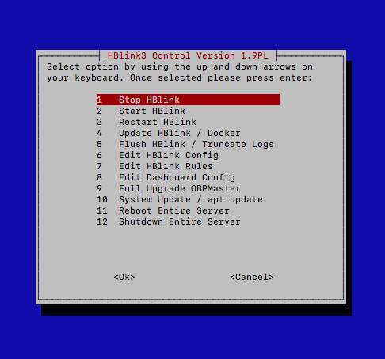

# HBlink3 Docker Installer
Debian 11 / 12 / 13 and Ubuntu 22.04 / 24.04 LTS Support!!
=======
This is a multi-arch docker installer for HBlink3 and HBMonv2 combined for Debian 11, 12, 13 and Ubuntu 22.04, 24.04 LTS. 

**Important:** Destructive Installer!
This is a destructive installer and is recommended to be built on a freshly installed machine running Debian 11, 12, 13 or Ubuntu 22.04, 24.04 LTS.

**Note:** Debian 12 (Bookworm) and 13 (Trixie) along with Ubuntu 22.04 and 24.04 LTS are fully supported. HBlink3 and HBMonv2 both run as Docker containers on a shared bridge network (same layout as the XPeer / RYMonv3 stack). See [CHANGELOG.md](CHANGELOG.md) for version history and updates.


## Additional Features
### NEW! Parrot built in
Parrot is built into this install (Default disabled, see below how to enable the parrot feature!

### Docker Multi-Arch build
Docker container pre-built for multi-arch!

* x86_64
* arm64
* ppc64
* lots more!

This installer builds the entire HBlink server! It includes all of the dependencies needed to run HBlink3 and HBMonv2 within docker via docker-compose. HBMonv2 is a dashboard designed for HBlink3 by SP2ONG, re-factored by M0VUB. Both services run in Docker on a private bridge (`172.16.238.0/24`), matching the XPeer installer (RYSEN + RYMonv3).

This installer includes all the usual libs and packages including docker, apache2 and php. It is recommended that you 
install this on a 'clean machine'. The script is destructive and is not designed to be used on an existing machine that has other software on it! YOU HAVE BEEN WARNED!

### Prerequisite
The host system must be running Debian 11, 12, 13 or Ubuntu 22.04, 24.04 LTS. **Debian 10 and Ubuntu 20.04 are no longer supported** due to the requirement for Docker Compose v2. The installer has been tested on these OS versions and works on most architectures. The system requires, at a minimum; 1 core, 512mb of ram, the required spec to run docker and additional processes! The system must be up-to-date and have Git installed. You can install Git from the CLI.

**Docker Compose v2:** This installer exclusively uses Docker Compose v2 from the official Docker repositories. The docker-compose-plugin package is automatically installed, providing the `docker compose` command (note the space). A compatibility wrapper is also created to support the legacy `docker-compose` command (with hyphen) for backward compatibility with existing scripts.

Note* If you get Locale error(s) (LC_CTYPE=UTF-8, which is wrong) can happen when you login over ssh from a Mac to a linux box, and your terminal automatically sets environment variables. There's a checkbox for that. Uncheck it, and you're good to go.

Make sure your system is up-to-date and pull Git from the apt repo.
```sh
apt-get install -y git
```
### Installation
1. Preferably a clean Debian 11, 12, 13 or Ubuntu 22.04, 24.04 LTS system. **Debian 10 and Ubuntu 20.04 are no longer supported.** Make sure your system is up to date with the latest apt repository database. You must be super user "root" to run this installer successfully.
```sh
apt update
sudo su
```
2. Clone this repository to any directory of your choice. The installer will work from any location!
```sh
git clone https://github.com/ShaYmez/hblink3-docker-install
```
**Note:** While you can clone to any directory, `/opt` is still recommended for consistency.

3. Now enter into the cloned repo and execute the install script. No need to chmod as permissions are already satisfied.
```sh
cd hblink3-docker-install
./hblink3-docker-install.sh
```
4. Follow the install and any prompts! It will prompt you for kernel updates if necessary.
5. Once the installation is complete you will be presented with the first time run menu. Edit your config or exit to complete setup.

### New Menu System released with this installer!



6. Once the installation is complete you will be guided to the Setup Menu. To interact with this menu follow the on-screen
instructions! Set up and configure your system with the new menu system! Once finished hit 'Finish Setup & Exit' to exit out of the setup menu.

7. To enter the HBlink control menu, type the command
```sh
hblink-menu
```
8. To interact with the routine scripts manually you can enter the comands directly without the use of the menu
```sh
hblink-start
hblink-stop
hblink-restart
hblink-flush
hblink-update
hblink-uninstall
```

### Uninstallation
To completely remove HBlink3 and all its components from your system, you can use the uninstall script:
```sh
hblink-uninstall
```
or
```sh
hblink-menu
```
Then select option 11 "Uninstall HBlink3"

The uninstall script will:
- Stop all HBlink3 services (Docker containers: `hblink` and `hbmon`)
- Remove Docker containers and HBlink / HBMon images
- Remove leftover systemd service files if present
- Remove cron jobs
- Remove control scripts from /usr/local/sbin
- Backup configurations to /root/hblink3-backup-[timestamp]
- Remove installation directories (/etc/hblink3, /opt/HBMonv2, /var/log/hblink, /var/log/hbmon)
- Restore default Apache index page

**Note:** Docker, Apache2, PHP, and other system packages will NOT be removed during uninstallation.

9. To interact with HBlink3 manually using docker you need to enter the HBlink3 directory
```sh
cd /etc/hblink3
```
10. You can only interact with HBlink3 in this directory. Use the following commands to interact with the installation. This installer uses Docker Compose v2 (docker-compose-plugin):
```sh
docker compose up -d       # Start containers (Docker Compose v2)
docker compose down        # Stop containers
docker compose restart     # Restart containers
docker compose pull        # Update images
sudo nano docker-compose.yml
```
**Note:** The legacy `docker-compose` command (with hyphen) also works via a compatibility wrapper that forwards to `docker compose`, but using `docker compose` (with space) is recommended as the official Docker Compose v2 syntax.
11. Edit your configuration before deployment!
```sh
nano hblink.cfg
nano rules.py
nano config.py
```
12. Check the logs for errors!
```sh
docker container logs hblink
docker container logs hbmon
or
/var/log/hblink/hblink.log
/var/log/hbmon/hbmon.log
```
13. Interact with HBMonv2 (Dashboard engine, Docker)
```sh
docker compose -f /etc/hblink3/docker-compose.yml restart hbmon
docker container logs hbmon
```


Within this installation includes the new HBMonv2 by Weldek SP2ONG
* Better dashboard for monitoring per page
* Python build	
* Websocket connection to web interface	
* Can be easily secured by SSL / Websocket secure	
* Includes lastheard database with auto cron installed	
* Includes talkgroup html editable page	

### Technical Details - Docker stack

HBlink3 and HBMonv2 run as sibling containers on `app_net` (`172.16.238.0/24`):

- **hblink** (`shaymez/hblink3:latest`) at `172.16.238.10` — reporting socket `4321`
- **hbmon** (`shaymez/hbmonv2:latest`) at `172.16.238.12` — websocket `9000`
- Dashboard config: `/etc/hblink3/config.py` (`HBLINK_IP` must be the HBlink container address, not `127.0.0.1`)
- Alias JSON files are shared at `/etc/hblink3/json`
- Apache2 still serves the PHP dashboard from `/var/www/html`

This matches the XPeer installer layout (RYSEN + RYMonv3) and avoids host Python / systemd for the monitor.

## Easy Installation And Upgrade
Existing servers that still run HBMonv2 via systemd should **not** use a full reinstall (that overwrites `hblink.cfg` / `rules.py`). Use the upgrade script:

```sh
cd /opt/hblink3-docker-install    # or the path in /etc/hblink3/.installer_path
git pull
hblink-upgrade
```

If `hblink-upgrade` is still the old stub (`Nothing to upgrade`), run the copy from the repo after `git pull`:

```sh
bash usr/local/sbin/upgrade
```

That move:
- Keeps `hblink.cfg` and `rules.py`
- Stops and removes `hbmon.service`
- Installs compose with `hblink` + `hbmon` (`shaymez/hbmonv2:latest`)
- Migrates `/opt/HBMonv2/config.py` to `/etc/hblink3/config.py` and sets `HBLINK_IP = 172.16.238.10`
- Backs up first to `/root/hblink3-pre-upgrade-[timestamp].tar.gz`

To refresh Docker images only (already on the compose stack):

```sh
hblink-update
```

## Ports to forward
```sh
http 80/tcp
https 443/tcp
report 4321/tcp
websocket 9000/udp
MMDVM 62030-62031/udp
OBP 62032-62050/udp
ssh 22/tcp
```
## Enable the Parrot
This installer comes with the parrot disabled. To enable the parrot follow commands below..
Asuming you are super user root!
```sh
nano /etc/hblink3/docker-compose.yml
```
Scroll down to the bottom of this compose file and look for ```- 'PARROT_ENABLE=0'```
Edit this to enable the Parrot master server which will be excuted upun restart
```sh
- 'PARROT_ENABLE=1'
```
Ctrl X and save!
Now lets enable the peer to connect to the master in our config...
```sh
nano /etc/hblink3/hblink.cfg
```
Scroll down to the ```[Parrot]``` stanza and edit ```ENABLED: True``` to enable.
Next we have put an example rule in rules.py. Remove the ```#``` hashes to enable routing of the parrot.
```sh
nano /etc/hblink3/rules.py
```
Ctrl X and hit save!
Once done save this and enter the the HBlink control menu
```sh
hblink-menu
```
Select option 4 "Update HBlink / Docker
Watch the terminal for any errors while bringing up the project! You can use the parrot on TG9999 (Default) or edit for your own tastes!

### Postrequisite
Make sure you have properly configured your firewall!!! If using Vultr servers they come default with full firewall blockade! For initial testing
disable the firewall! 
```sh
ufw disable
``` 
### More to come...
We will be updating this repository to include more documentation. In the mean time learn about docker @ https://docker.com and visit the HBlink3 official repo for further documentation! https://github.com/HBLink-org/
